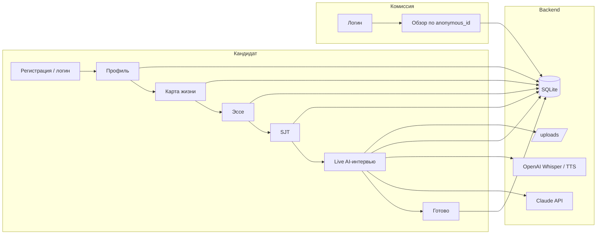

# inVision U — система отбора кандидатов

MVP для приёмной комиссии: кандидат проходит **многошаговую заявку** (профиль, интерактивная «карта жизни», эссе, ситуационный тест) и **живое видеоинтервью** с камерой и **голосовыми ответами** (распознавание речи и озвучка вопросов через API); комиссия просматривает заявки **анонимно** (в списках — без имён и школ). Дополнительно собираются **поведенческие сигналы с лица** (взгляд, blendshapes через MediaPipe в браузере) — как вспомогательный контекст, не как «детектор лжи». AI выставляет оценку с пояснениями по критериям; **финальное решение всегда за людьми**.

Проект создавался в рамках хакатона Decentrathon 5.0, трек AI inDrive.

---

## Содержание

1. [Возможности](#возможности)
2. [Состав проекта](#состав-проекта)
3. [Как это работает](#как-это-работает)
4. [Технологии](#технологии)
5. [Требования к окружению](#требования-к-окружению)
6. [Быстрый старт](#быстрый-старт)
7. [Переменные окружения](#переменные-окружения)
8. [Скрипты и команды](#скрипты-и-команды)
9. [Демо-аккаунты](#демо-аккаунты)
10. [Маршруты фронтенда](#маршруты-фронтенда)
11. [API и документация](#api-и-документация)
12. [Структура репозитория](#структура-репозитория)
13. [Сборка для продакшена](#сборка-для-продакшена)
14. [Ограничения и замечания](#ограничения-и-замечания)

---

## Возможности

- **Кандидат:** регистрация → **профиль** → **карта жизни** (timeline с обязательным «провалом» для темы эссе) → **эссе** (лимит слов, в проде вставка из буфера отключена, в dev — разрешена) → **SJT** (ситуационный тест) → **живое AI-интервью** (видеозапись, до 4 вопросов, таймеры подготовки/ответа, ответ **голосом**) → экран завершения.
- **Интервью в UI:** страница `/interview` — компонент `LiveVideoInterview`: вопросы генерирует **Claude** по эссе и истории реплик; **озвучка вопроса** — OpenAI TTS (`tts-1`) или запасной вариант через **Web Speech API** в браузере, если TTS недоступен; ответ кандидата — **Whisper** на бэкенде. Полная запись интервью сохраняется на сервер; в БД пишутся транскрипты как сообщения `InterviewMessage`.
- **Комиссия:** отдельный вход, дашборд, поиск, карточка кандидата по анонимному ID (там же — воспроизведение видео и визуализация **метрик поведения** при наличии `behavior_metrics`), история, настройки (**веса критериев** и **калибровка чувствительности** разбора взгляда/саккад).
- **Оценка:** веса по критериям (лидерство, мотивация, траектория, навыки, аутентичность); рядом показывается **baseline** (rule-based) для сравнения с ответом модели.
- **Языки интерфейса:** EN / RU / KZ (`react-i18next`).

---

## Состав проекта

**Фронтенд** — одно SPA на React: публичные страницы (лендинг, логины), кабинет кандидата (`Apply` — профиль, карта, эссе, SJT; `Interview` — **живое видеоинтервью** в `LiveVideoInterview.tsx` с **MediaPipe Face Landmarker**), кабинет комиссии (списки, карточка, поиск, история, настройки). Состояние входа хранится в контексте; токен JWT подставляется в заголовки Axios (`api/client.ts`). Локализация — файлы `src/i18n/*.json`.

**Бэкенд** — FastAPI-приложение с разделением по роутерам:

| Модуль | Назначение |
|--------|------------|
| `routes/auth.py` | Регистрация, логин, выдача JWT; у кандидата создаётся запись профиля `Candidate`. |
| `routes/candidates.py` | Сохранение анкеты и эссе, чтение своего профиля (`Bearer` только для роли `candidate`). |
| `routes/interview.py` | **Текстовый** сценарий интервью (`/start`, `/answer`, `/history`): вопросы от Claude, реплики в `InterviewMessage`; `/transcribe` — Whisper для голоса. В текущем UI страница `/interview` эти эндпоинты **не использует** (оставлены для API/отладки). |
| `routes/video_interview.py` | **Живое интервью:** `live-start` / `live-step` (сессия в памяти, STT + следующий вопрос + TTS), `finalize-video` (загрузка WebM, `video_url`, `behavior_metrics`, синхронизация с БД и фоновый скоринг). |
| `routes/commission.py` | Список и детали кандидатов для роли `commission` — в UI используется **анонимный ID**, а не ФИО/школа. |
| `routes/score.py` | Перезапуск или получение AI-оценки (см. Swagger). |
| `routes/analyze.py` | Отдельный эндпоинт анализа текста эссе на эвристические признаки «AI-текста» (не обязателен для основного сценария). |

**Сервисы** — бизнес-логика вне HTTP-слоя: `interview_service` (текстовый диалог с Anthropic), `video_interview_service` (live: Claude + **Whisper** + **TTS**), `whisper_service` (транскрипция для `/transcribe`), `ai_scorer` и пакет `invision_ai_core` (скоринг по критериям), `baseline_scorer`, `ai_detector`, `auth_service`, при необходимости `translation_service`.

**Данные** — SQLite; основные сущности: пользователь (`User` с ролью `candidate` или `commission`), профиль кандидата (`Candidate`, поле `anonymous_id` для показа комиссии, **`video_url`**, **`behavior_metrics`** — JSON отчёта с фронта), сообщения интервью (`InterviewMessage`). Номер шага заявки хранится в `application_step` (см. ниже).

**Хранение полей заявки (важно для интеграций):** бэкенд хранит «анкету» плоско; фронт кладёт **карту жизни** (массив событий) в `extra_activities` как JSON-строку, **ответы SJT** — в `leadership_examples` как JSON, **текст промпта эссе** (для отображения) — в `achievements`, сам текст эссе — в `essay` через отдельный `PUT .../essay`.

---

## Как это работает

### Роли и доступ

- После регистрации кандидат получает JWT и работает только с **своим** профилем через `/api/candidates/*` и `/api/interview/*`.
- Комиссия логинится отдельными учётками и вызывает `/api/commission/*`. В списках и карточках для отображения используется стабильный **`anonymous_id`**, чтобы снизить предвзятость.

### Воронка кандидата (`application_step`)

| Значение | Смысл |
|----------|--------|
| `0` | Профиль создан, анкета ещё не сохранена. |
| `1` | Анкета сохранена (`PUT .../questionnaire`). |
| `2` | Эссе сохранено (`PUT .../essay`). |
| `3` | Идёт интервью (для live после старта сессии реплики появляются в БД по мере шагов; текстовый `/start` тоже переводит сюда). |
| `4` | Интервью завершено; запускается расчёт AI-оценки в фоне. |

### Живое видеоинтервью (то, что видит пользователь на `/interview`)

1. Браузер запрашивает **камеру и микрофон** (`getUserMedia`), идёт запись **полного** видео (WebM).
2. Параллельно каждые **500 ms** снимаются **blendshapes лица** (MediaPipe Face Landmarker): взгляд в стороны (`eyeLookIn/Out*`), напряжение бровей, открытие челюсти — лог уходит в итоговый `behavior_report` на `finalize-video`.
3. Сессия live идентифицируется **`session_id`** (генерируется на клиенте); состояние шага хранится **в памяти процесса** бэкенда — при **перезапуске uvicorn** сессию нужно начинать заново.
4. На каждый вопрос: **~15 с** на подготовку, **до ~120 с** на голосовой ответ → загрузка аудио → **Whisper** → сохранение реплики кандидата и ответ AI в `InterviewMessage` → следующий вопрос + **TTS** (MP3 в base64 или озвучка в браузере).
5. После последнего ответа — загрузка **полного видео** и JSON метрик; выставляется шаг `4`, запускается фоновый скоринг (как ниже).

**Текстовый интервью-API** (`interview.py`): до **4 вопросов** от Claude по эссе и переписке; при перезагрузке страницы история читается из БД — удобно для альтернативного клиента без видео.

После завершения интервью (live или текстового сценария) бэкенд выставляет шаг `4` и ставит в очередь задачу скоринга: считаются AI-баллы и baseline, при необходимости детектор по эссе — результат попадает в поля профиля кандидата; комиссия видит обновлённый рейтинг после перезагрузки данных.

### Связь фронта и API в разработке

Браузер обращается к относительным путям `/api/...`. Dev-сервер Vite **проксирует** их на `http://127.0.0.1:8000`, поэтому cookie/CORS для типичного локального сценария не мешают. В продакшене без общего origin задаётся `VITE_API_BASE_URL`.

### Схема потока (упрощённо)



---

## Технологии

| Слой        | Стек |
|------------|------|
| Frontend   | React 19, TypeScript, Vite 8, Tailwind CSS, Framer Motion, Axios |
| Backend    | FastAPI, SQLAlchemy 2, SQLite, Pydantic |
| AI         | Anthropic Claude (скоринг и вопросы интервью) |
| Speech     | OpenAI Whisper + TTS (`tts-1`) для live-интервью; запасной TTS — Web Speech API в браузере |
| Поведение  | MediaPipe Face Landmarker (WASM), blendshapes в браузере |

---

## Требования к окружению

- **Python** 3.11+ (рекомендуется 3.12)
- **Node.js** 20+ и npm
- Аккаунт и **API-ключ Anthropic** для полноценной работы вопросов интервью (Claude) и AI-скоринга
- **API-ключ OpenAI** (`OPENAI_API_KEY` в `backend/.env`) для **живого** интервью: распознавание ответов (Whisper) и озвучка вопросов (TTS). Без ключа **Whisper не работает** — голосовой сценарий на `/interview` не сможет пройти; озвучка вопроса при этом может подменяться **Web Speech API** в браузере.
- Браузер с доступом к **камере и микрофону**; для MediaPipe при первом запуске подгружаются модели с CDN (нужна сеть).

На Windows команды `python` / `pip` могут быть доступны как `py` и `py -m pip` — используйте то, что установлено у вас.

---

## Быстрый старт

В репозитории **нет** каталогов `node_modules/` и `backend/.venv/` — они в `.gitignore` и ставятся локально (иначе клон весил бы сотни мегабайт). После клона нужен один раз `pip install` и `npm install` (см. ниже).

### Windows: один раз настройка, потом запуск (PowerShell)

Из корня репозитория:

```powershell
git clone https://github.com/pip00sya/invisionu-mvp.git
cd invisionu-mvp
.\setup.ps1
.\start.ps1
```

- **`setup.ps1`** — создаёт `backend\.venv`, ставит зависимости Python и выполняет `npm install` во `frontend`. Если файла `backend\.env` нет, копирует его из `.env.example` (в приватной копии репо `backend\.env` может уже лежать в git — тогда ключи подтянутся сами).
- **`start.ps1`** — открывает два окна: бэкенд (uvicorn `:8000`) и фронт (`npm run dev`, `:5173`).

Убедитесь, что в PATH есть **Python** и **Node.js** (см. [требования](#требования-к-окружению)).

### Вручную (Linux / macOS или без скриптов)

#### 1. Бэкенд

```bash
cd backend
python -m venv .venv
```

Активация виртуального окружения:

- **Windows (PowerShell):** `.\.venv\Scripts\Activate.ps1`
- **macOS / Linux:** `source .venv/bin/activate`

```bash
pip install -r requirements.txt
```

Создайте файл окружения из шаблона (если в клоне ещё нет `backend/.env`):

- **Windows (cmd):** `copy .env.example .env`
- **Windows (PowerShell):** `Copy-Item .env.example .env`
- **macOS / Linux:** `cp .env.example .env`

Откройте `backend/.env` и укажите `ANTHROPIC_API_KEY` и при необходимости `OPENAI_API_KEY` (см. [переменные окружения](#переменные-окружения)).

Запуск API (из папки `backend`):

```bash
uvicorn main:app --reload --host 127.0.0.1 --port 8000
```

При старте приложение само создаёт таблицы в SQLite и поднимает демо-пользователей комиссии (как при ручном запуске `seed_data.py`).

#### 2. Фронтенд

В **новом** терминале:

```bash
cd frontend
npm install
npm run dev
```

Откройте в браузере: **http://localhost:5173**

В режиме разработки запросы к API идут на префикс `/api` и **проксируются** на `http://127.0.0.1:8000` (см. `frontend/vite.config.ts`).

### Проверка API

- Корень: http://127.0.0.1:8000/
- Здоровье: http://127.0.0.1:8000/health
- Swagger UI: http://127.0.0.1:8000/docs

---

## Переменные окружения

Файл: **`backend/.env`** (шаблон — `backend/.env.example`).

В **этой** приватной копии репозитория файл `backend/.env` может быть закоммичен, чтобы после `git clone` не настраивать ключи вручную. Для любого **публичного** репозитория так делать нельзя: держите только `.env.example`, а секреты — вне git; если репо когда-либо станет публичным, **смените все ключи**, которые попадали в историю коммитов.

| Переменная | Обязательность | Описание |
|------------|----------------|----------|
| `ANTHROPIC_API_KEY` | Да, для AI | Ключ API Anthropic (Claude). Без него вопросы интервью и скоринг через модель не заработают. |
| `OPENAI_API_KEY` | Да, для **полного** live-интервью | Whisper (транскрипция голоса) и TTS (озвучка вопросов MP3). Если не задан: TTS может замениться `speechSynthesis` в браузере; **Whisper недоступен** — шаги с голосовым ответом не пройти. |
| `DATABASE_URL` | Нет | По умолчанию используется SQLite `backend/invisionu.db`. В `.env.example` указано `sqlite:///./invisionu.db` — путь приводится к каталогу `backend/`. |
| `ANTHROPIC_SCORING_MODEL` | Нет | ID модели для скоринга (см. `services/invision_ai_core/pipeline.py`). По умолчанию: `claude-sonnet-4-6`. |

**Фронт (опционально):** `VITE_ALLOW_ESSAY_PASTE=true` при сборке — разрешить вставку в поле эссе вне dev-режима (по умолчанию в прод-сборке вставка блокируется).

**Продакшен-фронт:** если UI открывается не с того же хоста/порта, что и API, задайте при сборке `VITE_API_BASE_URL`, например:

```bash
set VITE_API_BASE_URL=https://api.example.com
npm run build
```

(В Linux/macOS: `export VITE_API_BASE_URL=...`.)

На бэкенде в `main.py` для CORS перечислены `http://localhost:5173`, `5174`, `3000` — при другом origin добавьте его в `allow_origins`.

---

## Скрипты и команды

### Корень репозитория (Windows)

| Скрипт | Назначение |
|--------|------------|
| `.\setup.ps1` | Первый запуск после клона: venv, `pip install`, `npm install`; при отсутствии `backend\.env` — копия из `.env.example` |
| `.\start.ps1` | Запуск бэкенда и фронта в отдельных окнах PowerShell |

### Backend

| Команда | Назначение |
|---------|------------|
| `uvicorn main:app --reload --host 127.0.0.1 --port 8000` | Разработка с автоперезагрузкой |
| `python seed_data.py` | Явно создать демо-пользователей комиссии (дублирует логику старта `main.py`) |

### Frontend

| Команда | Назначение |
|---------|------------|
| `npm run dev` | Dev-сервер Vite |
| `npm run build` | TypeScript + production-сборка в `frontend/dist` |
| `npm run preview` | Локальный просмотр собранного `dist` |
| `npm run lint` | ESLint |

---

## Демо-аккаунты

Учётные записи **комиссии** (роль `commission`), пароли для локальной разработки:

| Email | Пароль |
|-------|--------|
| `commission1@invisionu.kz` | `commission123` |
| `commission2@invisionu.kz` | `commission123` |
| `admin@invisionu.kz` | `admin123` |

Кандидаты регистрируются через UI (`/register`); отдельных тестовых логинов в репозитории нет.

---

## Маршруты фронтенда

| Путь | Кто | Описание |
|------|-----|----------|
| `/` | Публично | Лендинг |
| `/register`, `/login` | Публично | Регистрация и вход кандидата |
| `/apply`, `/interview`, `/done` | Кандидат | Заявка (профиль → карта → эссе → SJT), живое видеоинтервью, завершение |
| `/commission/login` | Публично | Вход комиссии |
| `/commission`, `/commission/search`, `/commission/history`, `/commission/settings` | Комиссия | Дашборд и разделы |
| `/commission/candidate/:anonymousId` | Комиссия | Карточка кандидата по анонимному ID |

---

## API и документация

- Префикс REST-маршрутов: **`/api/...`** (например, `/api/auth/login`).
- Полный интерактивный список эндпоинтов: **http://127.0.0.1:8000/docs** (OpenAPI / Swagger).

Основные роутеры в коде: `auth`, `candidates`, `interview`, **`video_interview`** (префикс тот же `/api/interview`: `POST .../live-start`, `.../live-step`, `.../finalize-video`), `commission`, `score`, `analyze`.

Статические загрузки: **`GET /uploads/...`** — сохранённые видеозаписи интервью (см. `main.py`).

---

## Структура репозитория

```
invisionu-mvp-main/
├── backend/
│   ├── main.py                 # Точка входа FastAPI, CORS, подключение роутеров
│   ├── database.py             # SQLAlchemy engine, сессии, DATABASE_URL
│   ├── seed_data.py            # Демо-пользователи комиссии
│   ├── requirements.txt
│   ├── .env.example            # Шаблон переменных окружения
│   ├── invisionu.db            # SQLite (создаётся при работе; не коммитить в проде с данными)
│   ├── routes/
│   │   ├── auth.py             # Регистрация / логин, JWT
│   │   ├── candidates.py     # Анкета, эссе, шаги кандидата
│   │   ├── interview.py        # Текстовое интервью + /transcribe
│   │   ├── video_interview.py  # Live: live-start, live-step, finalize-video
│   │   ├── commission.py     # Анонимный просмотр для комиссии
│   │   ├── score.py          # Скоринг / перезапуск оценки
│   │   └── analyze.py        # Аналитика / вспомогательные эндпоинты
│   ├── models/
│   │   ├── db_models.py        # ORM-модели
│   │   └── schemas.py          # Pydantic-схемы
│   └── services/
│       ├── auth_service.py
│       ├── ai_scorer.py
│       ├── interview_service.py
│       ├── video_interview_service.py
│       ├── whisper_service.py
│       ├── baseline_scorer.py
│       ├── ai_detector.py
│       └── invision_ai_core/   # Промпты, пайплайн скоринга, утилиты
├── frontend/
│   ├── index.html
│   ├── vite.config.ts          # Прокси /api → backend :8000
│   ├── package.json
│   ├── dist/                   # Результат npm run build
│   └── src/
│       ├── App.tsx             # Маршрутизация
│       ├── api/client.ts       # Axios, baseURL, токен
│       ├── pages/
│       │   ├── Landing.tsx
│       │   ├── candidate/      # Register, Login, Apply, Interview, Done
│       │   └── commission/     # Login, Dashboard, CandidateView, Search, History, Settings
│       ├── components/         # LiveVideoInterview, SJTTest, TimelineBuilder, …
│       ├── context/            # AuthContext, CommissionContext
│       ├── i18n/               # en.json, ru.json, kz.json
│       └── types/
└── README.md
```

---

## Сборка для продакшена

1. Соберите фронт: `cd frontend && npm run build`.
2. Раздавайте содержимое `frontend/dist` через nginx / CDN / статику FastAPI (по выбору).
3. Запускайте API, например: `uvicorn main:app --host 0.0.0.0 --port 8000` (без `--reload` на бою).
4. Задайте `VITE_API_BASE_URL` при сборке фронта и при необходимости расширьте `allow_origins` в `main.py`.

---

## Ограничения и замечания

- **Детекция «AI-текста»** в эссе — эвристика (например, burstiness и лексика), не юридическое доказательство; это сигнал для внимания комиссии.
- **Метрики взгляда и поведения** строятся из blendshapes и эвристик на сервере — это **не** инструментальная психометрия и не «детектор обмана»; освещение, качество камеры и поза сильно влияют на числа.
- **Live-сессии** привязаны к процессу бэкенда; горизонтальное масштабирование без sticky-сессий или общего хранилища сессий потребует доработки.
- **Модель** может ошибаться на очень коротких или нестандартных ответах — поэтому в UI есть объяснения баллов и роль человека.
- **SQLite и локальный `.env`** подходят для MVP; для продакшена обычно нужны отдельная БД, секреты вне репозитория, HTTPS и политика хранения персональных данных (в т.ч. **видео** и биометрически близкие данные с камеры — уточните юридически).

---

## Критерии оценки (кратко)

| Критерий | Макс. баллы |
|----------|-------------|
| Лидерский потенциал | 25 |
| Мотивация и видение | 25 |
| Траектория роста | 20 |
| Навыки и опыт | 20 |
| Аутентичность | 10 |

Точные формулировки и отображение — в продукте и в ответах API.
