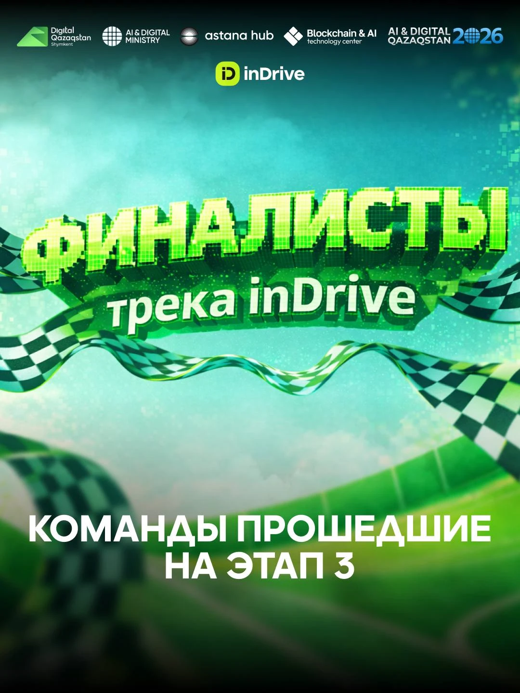
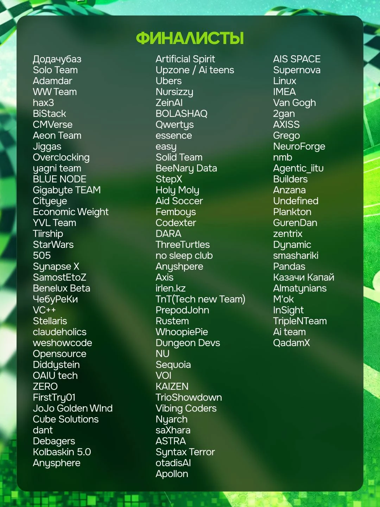

# inVisionU / Decentrathon 5.0: recognition and evidence

**Participation in the AI inDrive track at Decentrathon 5.0**, **27 March–5 April 2026**. The certificate names Shakhnazar Akhmer and carries the inVision U / inDrive event branding.

## Organizer announcement: finalist selection

**Finalist — Decentrathon 5.0, AI inDrive track · Team QwertyS.** The HackAlem Telegram announcement identifies finalists advancing to **Stage 3**. The roster spells the team name **Qwertys**, in the middle column, seventh entry. Shakhnazar Akhmer identified the listed team and its inVision U project.

[Full Telegram announcement screenshot](hackalem-finalists-announcement.png). Supplied by Shakhnazar Akhmer on 12 October 2026; the supplied images are preserved without modification. A direct Telegram post URL and publication timestamp were not supplied. This records finalist selection; the separate personal certificate below records participation.

## Decentrathon 5.0 — participation, AI inDrive track

[Open the original document](decentrathon5-participation.pdf)

## Document provenance

Supplied by Shakhnazar Akhmer on 12 October 2026. Original documents are preserved byte for byte; PNG previews of PDFs are page renders. Project associations follow the submitted project records and Shakhnazar’s identification of the events.

[File checksums](manifest.json) · [Back to the project](../../README.md)
